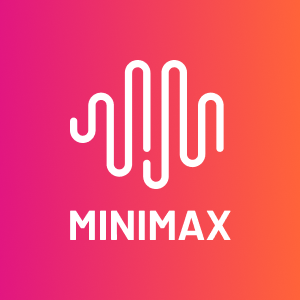

# cpa-minimax

<p align="center">
  
</p>

<p align="center">
  <strong>English</strong> · <a href="README.zh-CN.md">简体中文</a>
</p>

<p align="center">
  <a href="#install">install</a> ·
  <a href="#configuration">configuration</a> ·
  <a href="docs/configuration.md">config reference</a> ·
  <a href="#quotas">quotas</a> ·
  <a href="docs/protocol-conversion.md">protocol guide</a> ·
  <a href="https://github.com/dillonzq/cpa-minimax/releases">releases</a>
</p>

<p align="center">
  <a href="LICENSE"></a>
  <a href="https://help.router-for.me/plugin/development"></a>
  <a href="go.mod"></a>
</p>

A native Go plugin for [CLIProxyAPI](https://help.router-for.me/plugin/development) (CPA) that connects MiniMax subscription and pay-as-you-go keys through one provider.

- Chat Completions, Messages, Responses, and Gemini clients, including streaming, through [apix](https://github.com/dillonzq/apix/tree/v0.1.0).
- International and China mainland credentials in one pool, with shared and per-key upstream addresses.
- Subscription-first scheduling through CPA priorities, error-based cooldowns, and native quota reporting.
- Built-in MiniMax-M3.1-Flash and MiniMax-M3, optional model discovery, thinking controls, and Claude-format token counting.

**Plugin ID:** `cpa-minimax` · **Provider and default model prefix:** `minimax`

## Requirements

- **CLIProxyAPI**: `v8.0.0+`
- **Source builds only**: Go 1.26.10+, CGO enabled, and a C compiler targeting the CPA host platform. Prebuilt release libraries do not require a Go toolchain or compiler.

## Install

Download the ZIP for your version and `checksums.txt` from [GitHub Releases](https://github.com/dillonzq/cpa-minimax/releases). Choose the **CPA host's operating system and architecture**, using the environment inside the container for container deployments:

| OS | Architecture | ZIP suffix | Library |
|---|---|---|---|
| Linux | amd64 / arm64 | `linux_amd64.zip` / `linux_arm64.zip` | `cpa-minimax.so` |
| macOS | amd64 / arm64 | `darwin_amd64.zip` / `darwin_arm64.zip` | `cpa-minimax.dylib` |
| Windows | amd64 / arm64 | `windows_amd64.zip` / `windows_arm64.zip` | `cpa-minimax.dll` |
| FreeBSD | amd64 | `freebsd_amd64.zip` | `cpa-minimax.so` |

1. Verify the download: `sha256sum <archive>` on Linux, `shasum -a 256 <archive>` on macOS, or `Get-FileHash <archive> -Algorithm SHA256` in PowerShell, and compare with `checksums.txt`.
2. Stop CPA and back up `config.yaml`, the `auth-dir` credential directory, and existing plugin libraries.
3. Place the library in `<cliproxyapi_root>/plugins/<os>/<arch>/`, such as `plugins/linux/amd64/`.
4. Enable `plugins.enabled` and `plugins.configs.cpa-minimax.enabled` and add your keys (see [Configuration](#configuration)).
5. Restart CPA, check its logs, verify `GET /v1/models` with a CPA client key, and make a real request.

## Configuration

```yaml
plugins:
  enabled: true
  configs:
    cpa-minimax:
      enabled: true
      api-keys:
        - value: "${MINIMAX_API_KEY}"
```

Set `MINIMAX_API_KEY` in the CPA process environment before starting CPA. For a China mainland key, add `region: cn` under `enabled: true` in this plugin’s configuration. Use a CPA client key for `/v1/models` and inference requests; MiniMax keys belong only in the plugin configuration.

The default region is `global`. Both plugin switches must be enabled. Use `type: subscription` or `type: api` to declare the billing type; see [Credentials and rotation](#credentials-and-rotation). The [configuration reference](docs/configuration.md) covers mixed regions, per-key `base-url`, all options, and credential files.

### Verify the installation

After restarting CPA, use its client-facing address and a **CPA client key**. The shell examples assume `CPA_BASE_URL` and `CPA_CLIENT_KEY` are set; omit a trailing `/` from the base URL.

```sh
curl --fail-with-body "${CPA_BASE_URL}/v1/models" \
  -H "Authorization: Bearer ${CPA_CLIENT_KEY}"

curl --fail-with-body "${CPA_BASE_URL}/v1/chat/completions" \
  -H "Authorization: Bearer ${CPA_CLIENT_KEY}" \
  -H "Content-Type: application/json" \
  -d '{"model":"minimax/MiniMax-M3","messages":[{"role":"user","content":"Hello"}],"max_tokens":128}'
```

The model list should include `minimax/MiniMax-M3` and `minimax/MiniMax-M3.1-Flash` with the default prefix. Listing models checks registration; the second call also checks the selected MiniMax credential and upstream connectivity.

## Credentials and rotation

### Credential types

| Type | `type` value | How it is billed | Default priority |
|---|---|---|:-:|
| M Plan subscription key | `subscription` | Subscription usage | `1` |
| Pay-as-you-go API key | `api` | Account balance | `0` |

An explicit `type` wins. Without it, `sk-cp-` keys are classified as `subscription` and other keys as `api`. This is a local prefix heuristic, not an API lookup or verification of the account’s billing plan. Set `type` explicitly when the prefix does not match the credential’s actual type. M Plan was formerly called Coding Plan / Token Plan.

### Regions

| Region | `region` value | Default host |
|---|---|---|
| International | `global` (default) | `https://api.minimax.io` |
| China mainland | `cn` | `https://api.minimax.cn` |

A key must use its own site. The top-level `region` supplies the default for keys without one. Upstream address priority is **per-key `base-url` → explicit shared `base-url` → the key region’s default host**. See the [routing examples](docs/configuration.md#regions-and-upstream-addresses).

### Rotation and cooldown

CPA selects available credentials with the highest `priority`, rotating within that group. Defaults prefer subscription keys (`1`) over API keys (`0`); API keys become eligible when no higher-priority subscription credential is available. Give every key the same priority to rotate both types together.

The plugin classifies MiniMax failures; CPA owns retries and cooldowns. A file-level `priority` set through CPA management overrides the plugin value. Configuration priority changes take effect when CPA reparses credentials, for example after a restart.

Configured keys are materialized as CPA credential files. Removing a key from YAML does **not** delete its file; remove it through CPA management. See [Credential files](docs/configuration.md#credential-files) for names, field precedence, and manual records.

## Models

| Model | Context | Max output | Thinking levels | Thinking off |
|---|--:|--:|---|:-:|
| `MiniMax-M3.1-Flash` | 1,000,000 | 524,288 | low, medium, high, xhigh, max | ✗ |
| `MiniMax-M3` | 1,000,000 | 524,288 | none, low, medium, high, xhigh, max | ✓ |

These are the plugin’s built-in catalog limits, not a guarantee of access for every key. They are available without discovery unless disabled by configuration. Model IDs use `minimax/<model>` by default; `model-prefix` changes or removes that prefix.

Discovery uses the first configured `api` key, or the first key when there is no API key, against that key’s resolved upstream address. It adds routable `MiniMax-M*` models and skips unrelated speech, video, and image models. On discovery failure, built-in and declared models remain; `catalog.stale-while-unavailable` controls whether the previous discovery results remain.

M2.5 and M2.7 are not published by default. They appear only when discovered or declared under `models`; check MiniMax’s [model lifecycle notice](https://platform.minimax.io/docs/faq/models) before using legacy IDs.

### Thinking behavior

- **Chat `reasoning_split`** defaults to `true`, so thinking arrives in `reasoning_content` rather than `<think>` tags inside `content`. M3.1 Flash always gets `true`.
- **M3.1 Flash** always thinks. Effort `none` becomes `low` (CPA does the same for models that cannot turn thinking off), and a Messages `thinking` object becomes `{"type":"adaptive"}`.
- **M3 on Messages** does not think unless asked. Effort `none` sends `thinking: {"type":"disabled"}`; any other effort enables adaptive thinking.
- **Model-name suffixes** such as `minimax/MiniMax-M3(high)` or `(none)` replace the body's reasoning control. The suffix is stripped for routing.

## Protocol selection

The plugin assigns these default upstream routes to `MiniMax-M*` models; actual availability is enforced by MiniMax:

| Protocol | Endpoint |
|---|---|
| Messages (Anthropic-compatible, recommended by MiniMax) | `/anthropic/v1/messages` |
| Chat Completions (OpenAI-compatible) | `/v1/chat/completions` |
| Responses | `/v1/responses` |

Each request uses the first protocol the model serves in the client format's order:

| Client format | Order |
|---|---|
| Chat Completions | Chat Completions → Responses → Messages |
| Responses | Responses → Chat Completions → Messages |
| Messages | Messages → Responses → Chat Completions |
| Gemini | Messages → Responses → Chat Completions |

The client's own protocol needs no conversion. Gemini has no MiniMax endpoint and converts to Messages, which MiniMax recommends for thinking blocks and interleaved thinking. All protocols authenticate with `Authorization: Bearer`.

Use `models[].protocols` to enable or disable one model’s routes, and `protocols` to override endpoint paths globally. See [Model and protocol overrides](docs/configuration.md#model-and-protocol-overrides) and the [protocol conversion guide](docs/protocol-conversion.md) for mappings and conversion losses.

## Quotas

Discover support with `GET /v0/management/quota/providers`, then call `POST /v0/management/quota/fetch` with `{"auth_index":"<selected index>"}`. Both need the CPA management key. The plugin queries the selected credential only.

**Subscription keys** call `GET /v1/token_plan/remains` on the key's resolved upstream host, with `/v1/api/openplatform/coding_plan/remains` as a fallback for eligible failures. Each `model_remains` entry becomes a group (for example `MiniMax-M*`) with:

| Bucket | Source | Reset |
|---|---|---|
| `rolling` | `current_interval_total_count` / `current_interval_usage_count` | `end_time` |
| `weekly` | `current_weekly_total_count` / `current_weekly_usage_count` | `weekly_end_time` |

A window whose total is `0` is unlimited and omitted. The plugin interprets `*_usage_count` as the **remaining** count by default; if your account reports the used count, set `quota.usage-count: used`. Invalid readings return an error, not an invented zero.

**Pay-as-you-go keys** report `Pay-as-you-go` as the plan without usage buckets. The plugin does not query the account balance; exhaustion is handled through error 1008, which cools the key down (402). Check the balance in the MiniMax console.

Authentication failures stop the quota lookup without trying the next endpoint. Quota reset is unsupported.

## Troubleshooting

Check the CPA log and the selected credential’s type, region, and resolved address first. MiniMax codes in `base_resp.status_code` or error messages take precedence over the upstream HTTP status; a non-zero `base_resp` also fails an HTTP-success response. The following describes the default behavior of the pinned CPA v8.0.0 host.

| MiniMax error | Meaning | Status | CPA behavior |
|---|---|:-:|---|
| 1004, 2049 | Invalid key or wrong region | 401 | Cool down 30 minutes |
| 1008 | Pay-as-you-go balance exhausted | 402 | Cool down 30 minutes |
| 2057, 2061, 2068 | Key or plan cannot use this endpoint or model | 403 | Cool down 30 minutes |
| 2053, 2056, 2067 | Plan usage or credits exhausted for the window | 429 | Quota backoff |
| 1002, 1041, 1045, 2045–2047, 2062 | Rate limited, including peak-time plan throttling | 429 | Quota backoff |
| 1000, 1001, 1024, 1033, 1039, 2064, 2066, HTTP 529 | Transient or overloaded | 503 | Short cooldown, retry |
| 2013 | Invalid parameters | 400 | Not retried |
| 2022, 2069 | Unknown or retired model | 404 | Not retried |

| Symptom | What to check |
|---|---|
| Plugin or models missing | Library OS/architecture, both `enabled` switches, startup logs, and `model-prefix`. |
| `invalid_config` | At least one unique, non-empty key; variables visible to the CPA process; HTTPS URLs unless `allow-http: true`. |
| 1004 or repeated 401 | Key validity, its site, and any shared/per-key address override. |
| Only built-in models appear | Discovery logs and permission to list `/v1/models`; an API key is preferred for discovery. |
| No quota buckets for an API key | Expected: pay-as-you-go credentials report the plan only. |
| Deleted YAML key still appears | Delete its retained credential file through CPA management. |

For a reproducible bug, open an [issue](https://github.com/dillonzq/cpa-minimax/issues/new/choose) with sanitized config, request, versions, and logs. Report vulnerabilities [privately](SECURITY.md).

## Limitations

- CPA's plugin error envelope carries no retry-after, so a 429 uses CPA's quota backoff rather than the window's reset time.
- Conversion can omit fields or reject unrepresentable content. A model’s presence in the catalog does not guarantee upstream access.

## Development

Source builds require Go 1.26.10+, CGO, and a C compiler for the target platform. Use the `debug` tag for local shared libraries:

```sh
go mod download all
go build -tags debug -buildmode=c-shared -o plugins/linux/amd64/cpa-minimax.so .
```

For other platforms, test commands, the offline host ABI suite, and release checks, see [CONTRIBUTING.md](CONTRIBUTING.md).

## Documentation

- [Configuration reference](docs/configuration.md): full example, defaults, addresses, model overrides, and credential files.
- [Protocol conversion](docs/protocol-conversion.md): field preservation, reasoning replay, tools, and streaming limits.
- [Contributing and release checks](CONTRIBUTING.md) · [Security policy](SECURITY.md) · [Release notes](RELEASE_NOTES.md).

## License and trademarks

The plugin code is [MIT licensed](LICENSE). The official MiniMax logo is used to identify the upstream service; its name and mark are not covered by that license. This project is independently maintained and is not affiliated with or endorsed by MiniMax. See [asset provenance and trademark notes](assets/README.md), including the plugin store icon URL.
